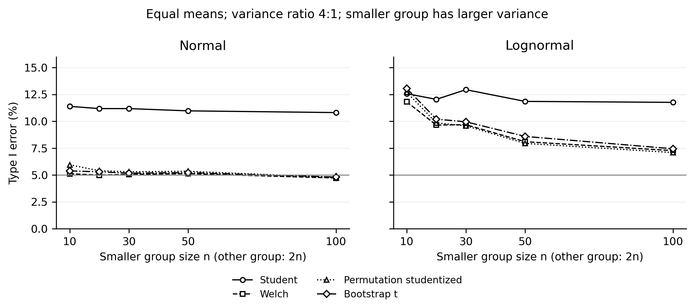

# When p-values mislead in small samples

A reproducible simulation of **135 scenarios and 1.35 million synthetic two-group datasets**, comparing hypothesis tests and confidence intervals under normality, skewness, heavy tails, and unequal variances. A separate experiment evaluates multiple-testing adjustments.

The question is practical: how does an analysis procedure behave under the conditions of a small study, including any selection of results by statistical significance?

## A result worth paying attention to

For two normal, equal-variance groups of 10 observations, with a true mean difference of **0.5**:

| Results retained | Average estimated mean difference |
| --- | ---: |
| All 10,000 simulated studies | 0.501 |
| Only the 1,833 results with Welch p < 0.05 | 1.097 |

Filtering by significance more than doubled the average reported effect. This is **selection bias**, not evidence that the unconditional arithmetic mean-difference estimator is biased.

Source: [selection_bias.csv](results/published/selection_bias.csv), scenario 1, Welch.

## Selected findings

All rows in the first table have **equal population means**, group sizes **10 and 20**, and population variance ratio **4:1**, with the larger variance in the smaller group. Nominal significance is 5%.

| Distribution | Student t | Welch t | Studentized permutation | Bootstrap-t interval exclusion |
| --- | ---: | ---: | ---: | ---: |
| Normal | 11.4% | 5.1% | 5.9% | 5.4% |
| Lognormal | 12.6% | 11.8% | 12.7% | 13.1% |

These are empirical type I error rates relative to equality of means. They demonstrate condition-specific behavior, rather than a universal ranking. With 10,000 repetitions, Monte Carlo SE is about 0.22 percentage points near a 5% rate and at most 0.50 percentage points.

Source: [single_tests.csv](results/published/single_tests.csv), scenarios 6 and 15.

For **20 independent normally distributed endpoints**, **30 observations per group**, equal variances, and **no true effects**, the probability of at least one false positive was:

| Analysis of Welch p-values | Family-wise error rate |
| --- | ---: |
| No multiplicity adjustment | 64.6% |
| Holm adjustment | 5.1% |

Source: [multiple_tests.csv](results/published/multiple_tests.csv), normal/equal/n1=30/nonnull=0.



## Methods

- Student and Welch two-sample t tests.
- Mann–Whitney U test, asymptotic with continuity correction.
- Raw and studentized permutation tests.
- Percentile and studentized bootstrap-t confidence intervals.
- Bonferroni, Holm, and Benjamini–Hochberg adjustments.

The main design crosses n = 10, 20, 30, 50, 100; normal, standardized lognormal, and standardized t₃ distributions; three combinations of group size and variance; and standardized mean shifts of 0, 0.5, and 0.8. Balanced groups contain n observations each; unbalanced groups contain n and 2n. Each scenario has 10,000 repetitions and 1,999 permutation/bootstrap resamples per dataset.

**The estimand matters.** Mann–Whitney is not a direct substitute for a test of equality of arithmetic means. Under heteroscedastic lognormal distributions, the means are equal while P(X < Y) ≈ 0.636. Rejection in that scenario cannot automatically be labeled a false positive for an equal-means question.

The [protocol](docs/protocol.md) specifies data generation, estimands, decision rules, uncertainty, seeds, and limitations. The analysis uses synthetic continuous data only. No patient data were used. This is an exploratory computational study, not a preregistered or peer-reviewed validation.

## Run locally

Python **3.12** and a **C++17 compiler** (`g++` or `clang++`) are required. Linux was tested. The build command includes macOS support but has not been tested on macOS; Windows is not supported directly. Use Linux/WSL for a Windows environment.

From the extracted repository directory:

```bash
python3.12 -m venv .venv
source .venv/bin/activate
python -m pip install -r requirements.txt

# Build the native routine and run independent numerical checks.
python validate.py

# One-scenario check using the published repetition counts.
python simulate.py --smoke --workers 1

# Reproduce all 135 scenarios and the multiple-testing experiment.
python simulate.py --workers 4

# Regenerate the same datasets for the selection analysis.
python supplementary.py

# Compare representative scenarios and all family/selection tables to the reference.
python check_reference.py

# Summarize the regenerated outputs and render the English figure.
python report.py --input-dir results/reproduced
```

For a quick summary of the shipped results, without a full rerun:

```bash
python report.py
```

New results go to `results/reproduced/`; smoke results go to its `smoke/` subdirectory. The CLI refuses writes inside `results/published/`. If memory is limited, reduce `--workers` to 1 or 2. Each worker holds two 10,000 × 1,999 resampling arrays plus data and quantile temporaries. Output paths can be changed with `--output-dir`. `CXX` can select a compiler.

Run one writer per output directory. Checkpoint files end in `.partial.csv`; the completed main table is renamed only after all requested scenarios finish. `run_metadata.json` records whether a run is smoke-only.

Exact floating-point agreement across library versions, compilers, or platforms is not guaranteed. The shipped versions and simulation settings are retained in [run_metadata.json](results/published/run_metadata.json).

## Files and result conventions

| File | Purpose |
| --- | --- |
| `simulate.py` | Data generation, main experiment, multiple-testing experiment, native build |
| `resample.cpp` | Per-scenario permutation and bootstrap kernel |
| `supplementary.py` | Conditional selection bias and numerical Mann–Whitney estimand |
| `validate.py` | Checks against SciPy, closed testing, exhaustive permutations, and repeatability |
| `check_reference.py` | Regression checks against shipped scenario and family outputs |
| `report.py` | CSV-derived summary and English figure |
| `results/published/` | Reference CSV outputs, metadata, and numerical validation |
| `docs/protocol.md` | Statistical methods, interpretation, scope, and references |
| `checksums.sha256` | SHA-256 checksums of the distributed reference outputs |

CSV probabilities are fractions, not percentages. `_mcse` fields report Monte Carlo SE. `rejection` is a decision frequency; its interpretation depends on the estimand and scenario. Coverage and bias fields are empty where a corresponding mean-difference interval/estimator comparison was not constructed. Bias is computed for the common arithmetic mean-difference estimator, not a different estimator for each test.

In `multiple_tests.csv`, `correction=None` means no adjustment. Read it with `pd.read_csv(..., keep_default_na=False)` so pandas does not convert this label to a missing value. FWER and FDR coincide under the global null; under mixed nulls they measure different quantities.

## Validation

Independent checks cover:

- Student and Welch p-values against SciPy on 300 datasets.
- Benjamini–Hochberg against SciPy and Holm against exhaustive closed Bonferroni testing.
- Native permutation probabilities against all 462 partitions of a small reference dataset.
- Bootstrap mean consistency, finite pivots, and exact repeatability with fixed seeds.

The public packaging also includes [regression checks](results/published/repository_checks.json) comparing selected complete scenario outputs and all multiple-testing outputs to the original reference results.

## Cite and reuse

Author: **Margarita Soloshenko**. Citation metadata is provided in [CITATION.cff](CITATION.cff). Code is released under the [MIT License](LICENSE). Methodological references are listed in the [protocol](docs/protocol.md#references).
